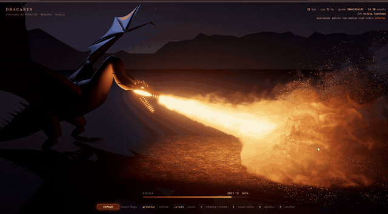
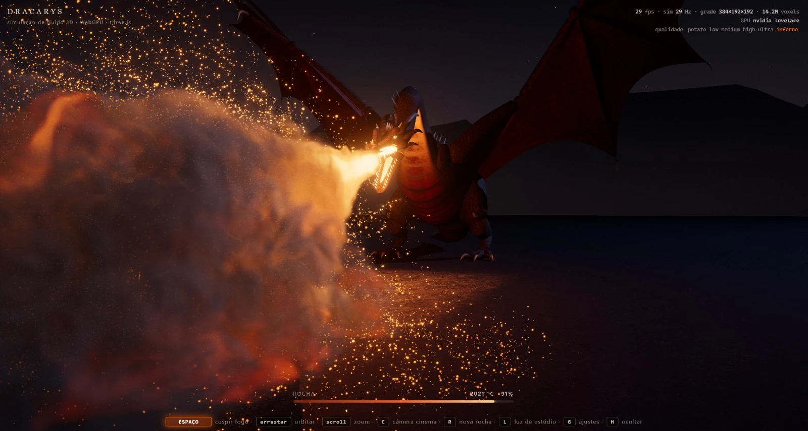
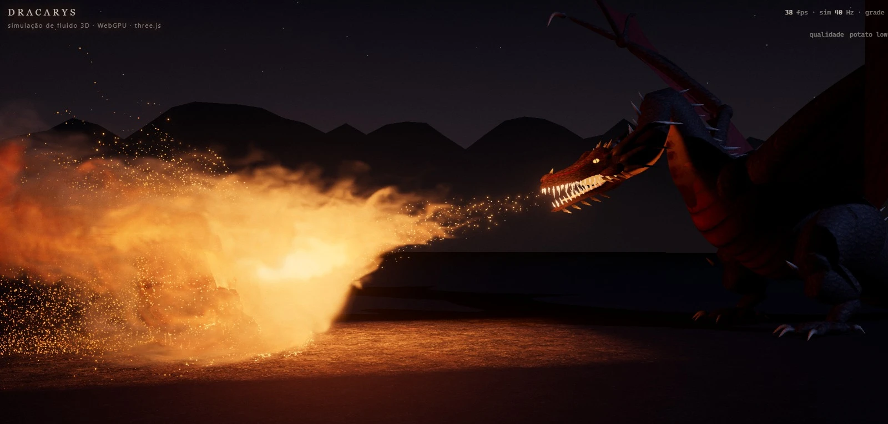
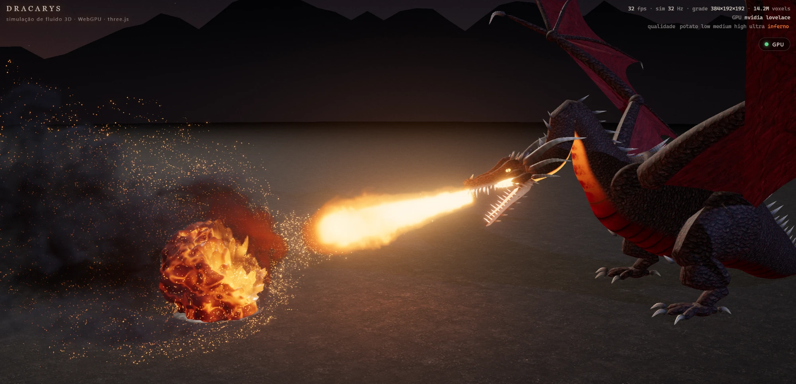

<div align="center">

# 🔥 Dracarys

**Real-time 3D fire simulation in the browser, with three.js and WebGPU**

**English** · [Português](README.pt-BR.md)

[](https://ai-fable5-2-fire-simulation.vercel.app/)
[](https://threejs.org/)
[](https://www.w3.org/TR/webgpu/)
[](https://vite.dev/)

[](docs/media/fire-simulation.mp4)

*Click the preview for the [full video](docs/media/fire-simulation.mp4) (18 s, 2530×1394, RTX 4060, `inferno` preset).*

**[▶ Open the live demo](https://ai-fable5-2-fire-simulation.vercel.app/)** · Chrome or Edge with WebGPU, ideally on a dedicated graphics card

</div>

---

**Author:** Alan Araya

**Goal:** a study of fire simulation with three.js, and of the capabilities of
Claude Fable 5.2 in designing a realistic simulation that runs in the browser
and makes heavy use of the GPU. The code, the research and the dragon model
were produced by Fable 5.2 in Claude Code sessions, with textures generated by
Codex.

| | |
|---|---|
|  |  |
| Front view, `inferno` preset (14.2 M voxels) | Profile: smoke lit by the fire itself |
|  | |
| The jet hits the rock, which cracks and melts | |

## What it is

This is a study of fire simulation and of what a browser can render today, not
a game. A dragon breathes fire on a rock until it melts. The fire is not a
sprite or a particle system: it is a **3D fluid simulation** (hot gas, smoke
and fuel) running entirely on the GPU in compute shaders, rendered by
**volumetric raymarching** with the true color of a heated black body.

The scene is there to put the simulation under load and show it from any
angle: hold `SPACE` to breathe fire, and the rock heats up, cracks, glows and
flows away as lava. The camera orbits freely while the fire is running.

## Running locally

```bash
npm install
npm run dev
```

Open http://localhost:5199 in Chrome or Edge (WebGPU required).

| Key | Action |
|---|---|
| `SPACE` (hold) | breathe fire |
| drag / scroll | orbit / zoom |
| `C` | cinematic camera (auto orbit) |
| `R` | new rock |
| `L` | studio light (to see the dragon and rock outside the night lighting) |
| `G` | tuning panel (fluid, gas appearance, scene) |
| `H` | hide HUD |

On touch devices a `FOGO` (fire) button appears.

### Quality

`?q=potato | low | medium | high | ultra | inferno`

| preset | gas grid | voxels | raymarch steps | gas advection |
|---|---|---|---|---|
| low | 128×64×64 | 0.5 M | 56 | semi-Lagrangian |
| medium | 192×96×96 | 1.8 M | 72 | MacCormack |
| high | 256×128×128 | 4.2 M | 96 | MacCormack |
| ultra | 320×160×160 | 8.2 M | 128 | MacCormack |
| inferno | 384×192×192 | 14.2 M | 176, full resolution | MacCormack |

Without `?q=`, quality follows the GPU the browser provided: `high` on a
dedicated card, `low` on an integrated GPU, `potato` on software rendering.

### Dedicated GPU (laptops with two GPUs)

On Windows, Chrome and Edge use **a single adapter for the whole browser** and
ignore WebGPU's `powerPreference: 'high-performance'` (Chrome's own
documentation says so). A web page has no way to request the dedicated card.
The simulator therefore reads `adapter.info`, detects an integrated GPU (Intel
UHD/Iris/Xe, integrated Radeon) or software rendering, and lowers the quality.

The **GPU** button in the top-right corner (green dot = dedicated card,
orange = integrated) opens a step-by-step guide, which also shows up as a
notice on the first visit with an integrated GPU. The user applies it once:

1. `chrome://flags/#force-high-performance-gpu` (or `edge://flags/...`) →
   *Enabled* → *Relaunch*; or
2. Windows Settings → System → Display → Graphics → browser →
   **High performance** → restart the browser; or
3. NVIDIA Control Panel / AMD Software → browser → high performance.

The guide has copy buttons for the addresses (`chrome://` pages cannot be
opened from a link) and adapts to the browser and operating system. The code
lives in `src/gpuHelp.js`.

### Deploying (Vercel)

Live at https://ai-fable5-2-fire-simulation.vercel.app/ (every push to `main`
redeploys).

It is a static site built by Vite. On Vercel: *Add New → Project*, import this
repository and accept the **Vite** preset (build `npm run build`, output
`dist`). Vercel serves over HTTPS, which WebGPU requires.

---

## Concepts

### 1. Fire is a fluid

Visible fire is hot gas that glows. For it to move like real fire (rise, curl,
tear into tongues and turn into smoke), the Navier-Stokes equations for an
incompressible fluid have to be solved on a 3D grid. Every 1/60 s step, the GPU
runs:

1. **Advection**: each cell looks backwards along the velocity ("where did the
   gas that is here now come from?") and copies the value from there. This is
   Stam's semi-Lagrangian method, unconditionally stable.
2. **Forces**: buoyancy (hot gas rises), the jet from the dragon's mouth, wind,
   drag and deflection at the rock surface.
3. **Pressure projection**: the resulting velocity field "leaks" mass; a
   Poisson equation for pressure is solved (Jacobi iterations) and its gradient
   is subtracted. What remains is a divergence-free flow, which is what gives
   the real swirling look.

### 2. Two grids

The detail the eye sees lives in the gas; velocity can be coarser. So there
are two grids:

- **gas** at full resolution: soot, temperature, fuel, burn rate (one RGBA 3D
  texture);
- **velocity and pressure** at half resolution on each axis: the pressure
  solver, the most expensive part, costs 8× less.

### 3. MacCormack advection (sharpness)

Semi-Lagrangian advection blurs: every step interpolates, and interpolating is
averaging. MacCormack (Selle et al. 2008) steps forward, steps back, measures
the error and corrects half of it. The result is clamped to the min and max of
the 8 cells read, so no values are invented. The backtrace uses RK2
(midpoint), which follows the curves of the flow better. This is only done for
the gas; velocity is smoother and semi-Lagrangian is enough.

### 4. Turbulence the grid cannot resolve

A 256-cell grid cannot capture the small eddies that give fire its torn look.
Three mechanisms bring that detail back:

- **Vorticity confinement** (Fedkiw et al. 2001): measures the curl of the
  field and pushes the fluid back into the vortices that numerical advection
  would have dissipated.
- **Divergence-free noise with a Kolmogorov spectrum**: a precomputed 3D
  texture summing 64 waves whose amplitude falls off as |k|^-5/6, the law of
  real turbulence. Being divergence-free, it stirs the gas without creating or
  destroying mass.
- **Sub-grid turbulence** on the gas only, in the advection backtrace: it tears
  the smoke into filaments finer than the velocity grid.

Viscosity depends on temperature: hot gas is more viscous and flows smoother,
cold smoke curls more.

### 5. Combustion

The dragon does not breathe "fire", it breathes **hot fuel**. Above ignition
temperature the fuel burns, releases heat and **expands** the gas (Feldman &
O'Brien 2003): burning enters the pressure solver as positive divergence,
which is what makes the flame swell and push the surrounding air. The jet has
a front and a tail that travel over time, so when the key is released the fire
detaches from the mouth and keeps going to the rock.

Gas that slows down loses heat faster, and **the lost heat becomes soot**:
smoke is born from the flames themselves, in the right places, instead of
coming from a separate emitter.

### 6. A melting obstacle

The rock is a mesh with per-vertex heat and melting, computed on the CPU with
conduction between neighbours. Above the melting point the vertices flow down
to the base, form a lava pool and drip.

For the fire to wrap around the melting rock, every few steps the mesh writes
its radius per direction into a **64×24 shape map** (azimuth × elevation). The
solver reads that map to know whether a cell is solid, and at the surface it
removes the normal component of the velocity: the fire slides over the rock
and spreads instead of passing through it.

### 7. Precomputed light

Lighting smoke with firelight would require, at every point, summing the light
from every other point. Instead:

1. A **gather** pass writes, on a 1/4 resolution grid, how much each region
   emits and how much it blocks.
2. That field is **diffused** 12 times (like heat spreading): the result
   approximates the firelight reaching each point. There is a near version at
   1/4 and a far one at 1/8.
3. The **moonlight shadow** is computed once per step at 1/2 resolution.

The raymarch and the ground only read these ready-made volumes. The same field
lights the dragon, the rock and the ground with the orange glow of the fire.

### 8. Skipping empty space

Most of the simulation box is empty. The alpha of the 1/8 light volume stores
an **occupancy mask** (dilated by 2 cells). The gas passes and the raymarch
check this tiny, always-cached texture and skip work where there is nothing.

### 9. Volumetric raymarching

`src/fireVolume.js` renders the gas in a compute pass into a reduced-resolution
HDR texture:

- **Black-body color**: a LUT built from Planck's law and converted to sRGB
  with Wyman's fit of the CIE functions. Simulation temperature becomes
  kelvin, and kelvin becomes the exact color of metal or gas at that
  temperature: dark red, orange, yellow, nearly white.
- **The flame has a body**: emission and absorption go together (Kirchhoff's
  law), so thick fire saturates at the color of its temperature and shows its
  outer shell instead of turning into a white blur.
- **Smoke with relief**: besides firelight and moonlight, the density gradient
  acts as a normal and sculpts the folds of the smoke.
- **Hue-preserving highlight compression**: bright light is compressed along
  its own color, so the core stays orange-yellow instead of cream.
- **Scene depth**: the ray stops at the dragon, the rock or the ground.
- **Jittered start + temporal filter**: each pixel starts its ray at a random
  offset (interleaved gradient noise), trading banding for noise; a temporal
  filter blends with the previous frame, clamped to the 3×3 neighbourhood to
  avoid ghosting.

Then come heat haze (the background shimmering behind the fire), bloom,
vignette, grain and ACES tone mapping.

### 10. Embers

Tens of thousands of GPU particles (`instancedArray` + compute) spawn at the
impact point and on the glowing rock and are carried by the simulation's own
velocity field, so they follow the fire's eddies.

### 11. Fixed timestep

The simulation runs at a fixed 1/60 s step, at most one step per frame (two
only when the frame is fast). If the GPU cannot hold 60 fps the fire runs in
slow motion instead of doubling the cost and spiralling into a performance
collapse.

## Files

| file | what it does |
|---|---|
| `src/fireSim.js` | fluid solver: grids, advection, combustion, pressure, light, mask |
| `src/fireVolume.js` | compute raymarch, temporal filter |
| `src/lut.js` | black-body LUT (Planck), divergence-free 3D noise |
| `src/rock.js` | rock: per-vertex heat and melting, lava, drips, shape map |
| `src/dragon.js` | dragon modelled in code: animated spine, skull, horns, wings |
| `src/embers.js` | GPU embers |
| `src/environment.js` | sky, moon, ground, firelight on surfaces |
| `src/gpuHelp.js` | GPU button, notice and dedicated-GPU guide |
| `src/main.js` | scene, main loop, post-processing, HUD, controls |
| `src/config.js` | quality presets, GPU detection and world layout |

### Art

The textures in `public/textures` (rock, ground, scales, belly scutes, wing
membrane) and the dragon concept in `art_source/dragon` were generated with
Codex (GPT image). The 3D dragon model is 100% procedural, built in code from
the concept: no image-to-3D service was used.

### Profiling

In the console: `await __fire.profile()` pauses the loop and returns the
average time of each stage in ms (gas, velocity, light, raymarch, post).

## References

- [lejrimostfa/force-field-vfx-threejs](https://github.com/lejrimostfa/force-field-vfx-threejs)
  (MIT): the solver structure (two grids, MacCormack on the gas only, 32-bit
  pressure with embedded solid flag, soot from lost heat, compute raymarch with
  temporal filter) follows the study of this project.
- three.js `webgpu_volume_fire` (official 3D fluid example in TSL)
- Stam, "Stable Fluids", SIGGRAPH 1999
- Crane et al., "Real-Time Simulation and Rendering of 3D Fluids", GPU Gems 3
- Fedkiw et al. 2001 (vorticity confinement); Selle et al. 2008 (MacCormack);
  Feldman & O'Brien 2003 (gas expansion)
- NVIDIA FlameWorks; "Ignis Divinus" (CS184): black-body LUT
