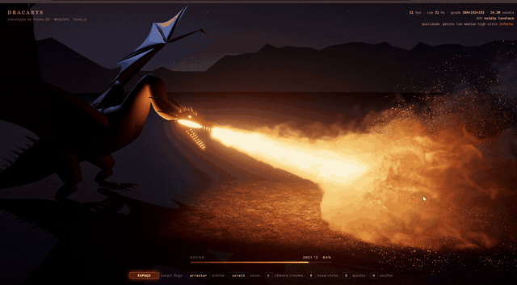
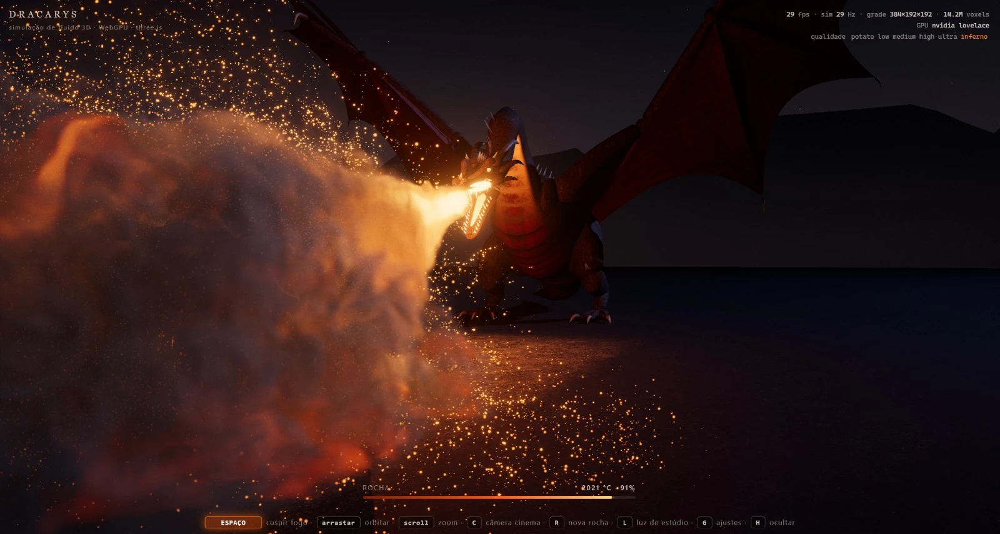
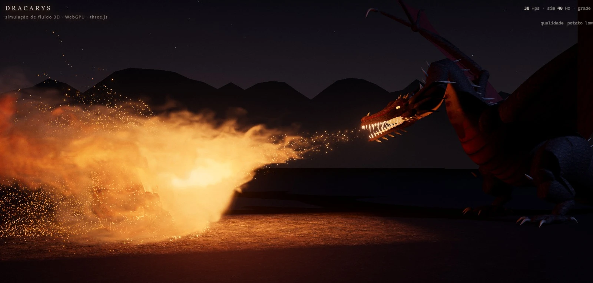
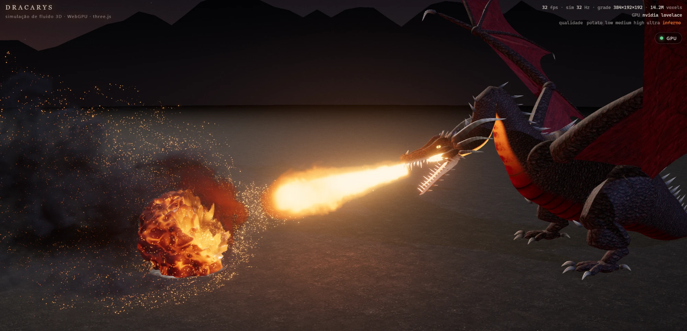

<div align="center">

# 🔥 Dracarys

**Simulação de fogo 3D em tempo real no navegador, com three.js e WebGPU**

[English](README.md) · **Português**

[](https://ai-fable5-2-fire-simulation.vercel.app/)
[](https://threejs.org/)
[](https://www.w3.org/TR/webgpu/)
[](https://vite.dev/)

[](docs/media/fire-simulation.mp4)

*Clique na prévia para ver o [vídeo completo](docs/media/fire-simulation.mp4) (18 s, 2530×1394, RTX 4060, preset `inferno`).*

**[▶ Abrir a demo ao vivo](https://ai-fable5-2-fire-simulation.vercel.app/)** · Chrome ou Edge com WebGPU, de preferência com placa de vídeo dedicada

</div>

---

**Autor:** Alan Araya

**Objetivo:** estudo sobre simulação de fogo com three.js e sobre as
capacidades do Claude Fable 5.2 em projetar uma simulação realista no
navegador, com uso extenso de recursos de GPU. O código, a pesquisa e o
modelo do dragão foram produzidos pelo Fable 5.2 em sessões do Claude Code,
com texturas geradas pelo Codex.

| | |
|---|---|
|  |  |
| De frente, preset `inferno` (14,2 M voxels) | De perfil: fumaça iluminada pelo próprio fogo |
|  | |
| O jato atinge a pedra, que racha e derrete | |

## O que é

Um estudo de simulação de fogo e das capacidades de renderização do navegador
atual, não um jogo. Um dragão cospe fogo numa pedra até ela derreter. O fogo
não é um sprite nem um sistema de partículas: é uma **simulação de fluido 3D**
(gás quente, fumaça e combustível) rodando inteira na GPU em compute shaders,
renderizada por **raymarching volumétrico** com a cor real de um corpo negro
aquecido.

A cena existe para pôr a simulação sob carga e mostrá-la de qualquer ângulo:
segure `ESPAÇO` para cuspir fogo, e a pedra esquenta, racha, brilha e escorre
em lava. A câmera gira livremente enquanto o fogo sai.

## Rodar

```bash
npm install
npm run dev
```

Abra http://localhost:5199 no Chrome ou Edge (precisa de WebGPU).

| Tecla | Ação |
|---|---|
| `ESPAÇO` (segurar) | cuspir fogo |
| arrastar / scroll | orbitar / zoom |
| `C` | câmera cinema (órbita automática) |
| `R` | nova rocha |
| `L` | luz de estúdio (para ver o dragão e a pedra fora da noite) |
| `G` | painel de ajustes (fluido, aparência do gás, cena) |
| `H` | ocultar HUD |

No celular aparece um botão `FOGO`.

### Qualidade

`?q=potato | low | medium | high | ultra | inferno`

| preset | grade de gás | voxels | passos do raymarch | advecção do gás |
|---|---|---|---|---|
| low | 128×64×64 | 0,5 M | 56 | semi-Lagrangiana |
| medium | 192×96×96 | 1,8 M | 72 | MacCormack |
| high | 256×128×128 | 4,2 M | 96 | MacCormack |
| ultra | 320×160×160 | 8,2 M | 128 | MacCormack |
| inferno | 384×192×192 | 14,2 M | 176, resolução cheia | MacCormack |

Sem `?q=`, a qualidade é escolhida pela GPU que o navegador entregou: `high`
em placa dedicada, `low` em GPU integrada, `potato` em renderização por
software.

### GPU dedicada (notebooks com duas GPUs)

No Windows, Chrome e Edge usam **um único adaptador para o navegador inteiro**
e ignoram `powerPreference: 'high-performance'` do WebGPU (a própria
documentação do Chrome diz isso). Uma página não tem como pedir a placa
dedicada. O simulador então lê `adapter.info`, detecta GPU integrada (Intel
UHD/Iris/Xe, Radeon integrada) ou software e reduz a qualidade.

O botão **GPU** no canto superior direito (ponto verde = placa dedicada,
laranja = integrada) abre um tutorial passo a passo, que também aparece como
aviso na primeira visita com GPU integrada. O usuário aplica uma vez:

1. `chrome://flags/#force-high-performance-gpu` (ou `edge://flags/...`) →
   *Enabled* → *Relaunch*; ou
2. Configurações do Windows → Sistema → Tela → Elementos gráficos → navegador
   → **Alto desempenho** → reiniciar o navegador; ou
3. Painel de controle da NVIDIA / AMD Software → navegador → alto desempenho.

O tutorial tem botões de copiar para os endereços (páginas `chrome://` não
podem ser abertas por link) e se adapta ao navegador e ao sistema. O código
fica em `src/gpuHelp.js`.

### Publicar (Vercel)

Publicado em https://ai-fable5-2-fire-simulation.vercel.app/ (cada push na `main` publica de novo).

É um site estático gerado pelo Vite. Na Vercel: *Add New → Project*, importe
este repositório e aceite o preset **Vite** (build `npm run build`, saída
`dist`). A Vercel serve por HTTPS, que o WebGPU exige.

---

## Conceitos

### 1. O fogo é um fluido

Fogo visível é gás quente que brilha. Para ele se mover como fogo de verdade
(subir, enrolar, se rasgar em línguas e virar fumaça) é preciso resolver as
equações de Navier-Stokes para um fluido incompressível numa grade 3D. A cada
passo de 1/60 s a GPU executa:

1. **Advecção**: cada célula olha para trás ao longo da velocidade ("de onde
   veio o gás que está aqui agora?") e copia o valor de lá. É o método
   semi-Lagrangiano de Stam, incondicionalmente estável.
2. **Forças**: empuxo (gás quente sobe), o jato da boca do dragão, vento,
   arrasto e a deflexão na superfície da pedra.
3. **Projeção de pressão**: o campo de velocidade resultante "vaza" massa;
   resolve-se uma equação de Poisson para a pressão (iterações de Jacobi) e
   subtrai-se o gradiente dela. O que sobra é um escoamento sem divergência,
   que é o que dá o aspecto de redemoinho real.

### 2. Duas grades

O detalhe que o olho vê mora no gás; a velocidade pode ser mais grosseira.
Então há duas grades:

- **gás** em resolução cheia: fuligem, temperatura, combustível, taxa de queima
  (uma textura RGBA 3D);
- **velocidade e pressão** em metade da resolução em cada eixo: o solver de
  pressão, que é a parte mais cara, custa 8× menos.

### 3. Advecção MacCormack (nitidez)

A advecção semi-Lagrangiana borra: cada passo interpola, e interpolar é tirar
média. MacCormack (Selle et al. 2008) faz o passo para frente, volta para trás,
mede o erro e corrige metade dele. O resultado é limitado ao mínimo e máximo
das 8 células lidas, para não criar valores que não existiam. O retrocesso usa
RK2 (ponto médio), que acompanha melhor as curvas do escoamento. Isso só é
feito no gás; na velocidade, que é mais suave, o semi-Lagrangiano basta.

### 4. Turbulência que a grade não resolve

Uma grade de 256 células não captura os redemoinhos pequenos que dão ao fogo
seu aspecto rasgado. Três mecanismos devolvem esse detalhe:

- **Confinamento de vorticidade** (Fedkiw et al. 2001): mede o rotacional do
  campo e empurra o fluido de volta para dentro dos vórtices que a advecção
  numérica teria dissipado.
- **Ruído sem divergência com espectro de Kolmogorov**: uma textura 3D
  pré-computada com a soma de 64 ondas cuja amplitude cai com |k|^-5/6, a lei
  da turbulência real. Por ser sem divergência, ela mexe o gás sem criar ou
  destruir massa.
- **Turbulência sub-grade** só no gás, no retrocesso da advecção: rasga a
  fumaça em filamentos mais finos do que a grade de velocidade.

A viscosidade depende da temperatura: gás quente é mais viscoso e escoa mais
liso, a fumaça fria se enrola mais.

### 5. Combustão

O dragão não cospe "fogo", cospe **combustível quente**. Acima da temperatura
de ignição o combustível queima, libera calor e **expande** o gás (Feldman &
O'Brien 2003): a queima entra como divergência positiva no solver de pressão,
e é isso que faz a chama inchar e empurrar o ar em volta. O jato tem frente e
cauda que viajam no tempo, então ao soltar a tecla o fogo se descola da boca e
segue até a pedra.

Gás que desacelera perde calor mais rápido, e **o calor perdido vira
fuligem**: a fumaça nasce das próprias chamas, nos lugares certos, em vez de
ser emitida por uma fonte separada.

### 6. Obstáculo que derrete

A pedra é uma malha com calor e derretimento por vértice, calculados na CPU
com condução entre vizinhos. Acima do ponto de fusão os vértices escorrem
para a base, formam uma poça de lava e pingam gotas.

Para o fogo contornar a pedra que está derretendo, a cada poucos passos a
malha grava seu raio por direção num **mapa de forma 64×24**
(azimute × elevação). O solver consulta esse mapa para saber se uma célula é
sólida, e na superfície remove a componente normal da velocidade: o fogo
desliza pela pedra e se espalha em vez de atravessá-la.

### 7. Luz pré-computada

Iluminar fumaça com luz do fogo exigiria, em cada ponto, somar a luz de todos
os outros pontos. Em vez disso:

1. Um passe de **coleta** grava, numa grade de 1/4 da resolução, quanto cada
   região emite e quanto ela bloqueia.
2. Esse campo é **difundido** 12 vezes (como calor se espalhando): o resultado
   aproxima a luz do fogo que chega a cada ponto. Há uma versão próxima em 1/4
   e uma distante em 1/8.
3. A **sombra do luar** é calculada uma vez por passo em 1/2 da resolução.

O raymarch e o chão só leem esses volumes prontos. O mesmo campo ilumina o
dragão, a pedra e o chão com a luz alaranjada do fogo.

### 8. Saltar o vazio

A maior parte da caixa de simulação está vazia. O alfa do volume de luz de 1/8
guarda uma **máscara de ocupação** (dilatada 2 células). Os passes do gás e o
raymarch consultam essa textura minúscula, sempre em cache, e pulam o trabalho
onde não há nada.

### 9. Raymarching volumétrico

`src/fireVolume.js` renderiza o gás em compute numa textura HDR de resolução
reduzida:

- **Cor de corpo negro**: uma LUT gerada pela lei de Planck e convertida para
  sRGB pela aproximação de Wyman das funções CIE. A temperatura da simulação
  vira kelvin, e o kelvin vira a cor exata de um metal ou gás àquela
  temperatura: vermelho-escuro, laranja, amarelo, quase branco.
- **A chama tem corpo**: emissão e absorção andam juntas (lei de Kirchhoff),
  então fogo espesso satura na cor da sua temperatura e mostra a casca de fora,
  em vez de virar um borrão branco.
- **Fumaça com relevo**: além da luz do fogo e do luar, o gradiente da
  densidade funciona como normal e esculpe as dobras da fumaça.
- **Compressão de brilho que preserva o tom**: o brilho forte é comprimido ao
  longo da própria cor, para o núcleo ficar laranja-amarelo e não creme.
- **Profundidade da cena**: o raio para no dragão, na pedra ou no chão.
- **Passo aleatório + filtro temporal**: cada pixel começa o raio num ponto
  aleatório (ruído de gradiente intercalado), o que troca faixas por ruído; um
  filtro temporal mistura com o frame anterior, limitado à vizinhança 3×3 para
  não deixar fantasmas.

Depois vêm distorção de calor (o fundo tremendo atrás do fogo), bloom,
vinheta, grão e tone mapping ACES.

### 10. Brasas

Dezenas de milhares de partículas em GPU (`instancedArray` + compute) nascem
no impacto e na pedra incandescente e são arrastadas pelo campo de velocidade
da própria simulação, então seguem os redemoinhos do fogo.

### 11. Passo fixo

A simulação roda em passo fixo de 1/60 s, no máximo um passo por frame (dois
só se o frame for rápido). Se a GPU não segura 60 fps o fogo anda em câmera
lenta em vez de dobrar o custo e entrar numa espiral de queda de desempenho.

## Arquivos

| arquivo | o que faz |
|---|---|
| `src/fireSim.js` | solver de fluido: grades, advecção, combustão, pressão, luz, máscara |
| `src/fireVolume.js` | raymarch em compute, filtro temporal |
| `src/lut.js` | LUT de corpo negro (Planck), ruído 3D sem divergência |
| `src/rock.js` | pedra: calor e derretimento por vértice, lava, gotas, mapa de forma |
| `src/dragon.js` | dragão modelado em código: espinha animada, crânio, chifres, asas |
| `src/embers.js` | brasas em GPU |
| `src/environment.js` | céu, lua, chão, iluminação do fogo nas superfícies |
| `src/main.js` | cena, laço principal, pós-processamento, HUD, controles |
| `src/gpuHelp.js` | botão GPU, aviso e tutorial da placa dedicada |
| `src/config.js` | presets de qualidade, detecção de GPU e layout do mundo |

### Arte

Texturas em `public/textures` (rocha, chão, escamas, escudos da barriga,
membrana da asa) e o concept do dragão em `art_source/dragon` foram gerados com
o Codex (GPT image). O modelo 3D do dragão é 100% procedural, construído em
código a partir do concept: nenhum serviço de imagem-para-3D foi usado.

### Medir

No console: `await __fire.profile()` pausa o laço e devolve o tempo médio de
cada etapa em ms (gás, velocidade, luz, raymarch, pós).

## Referências

- [lejrimostfa/force-field-vfx-threejs](https://github.com/lejrimostfa/force-field-vfx-threejs)
  (MIT): a estrutura do solver (duas grades, MacCormack só no gás, pressão em
  32 bits com sólido embutido, fuligem a partir do calor perdido, raymarch em
  compute com filtro temporal) segue o estudo deste projeto.
- three.js `webgpu_volume_fire` (exemplo oficial de fluido 3D em TSL)
- Stam, "Stable Fluids", SIGGRAPH 1999
- Crane et al., "Real-Time Simulation and Rendering of 3D Fluids", GPU Gems 3
- Fedkiw et al. 2001 (confinamento de vorticidade); Selle et al. 2008
  (MacCormack); Feldman & O'Brien 2003 (expansão do gás)
- NVIDIA FlameWorks; "Ignis Divinus" (CS184): LUT de corpo negro
